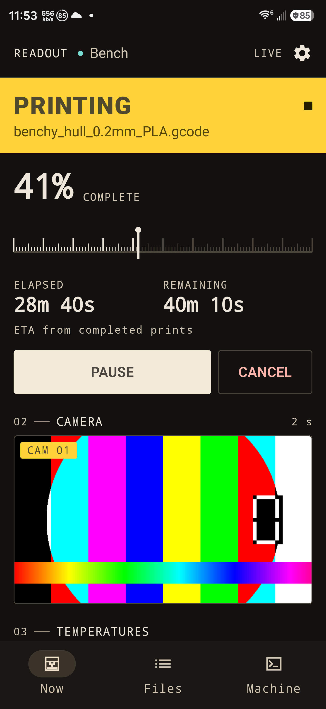

# Readout

A phone and watch control surface for a single OctoPrint printer. Everything stays on your network:
no account, no cloud, no analytics.



## Features

- **Now** — state, job, progress, elapsed/remaining with ETA provenance, camera still, temperatures,
  pause/resume/cancel.
- **Files** — filter, inspect, start, upload and batch-delete G-code; a layer-by-layer toolpath
  preview drawn from the file itself; timelapse archive with in-place playback.
- **Machine** — set temperature targets, jog in 1/10/50 mm steps, home, extrude, send G-code,
  connect/disconnect, and switch power outputs. Movement is locked while a job runs, with an opt-in
  in Settings → Machine.
- **Power** — PSU Control, OctoRelay and WLED appear as switches when their plugins answer.
- **Fleet** — several printers with a masthead switcher; pause, resume, cancel or start a file across
  a selection of them.
- **Surfaces** — three home-screen widgets, a live print notification with a pause action, and a
  standalone Wear OS app.

## Requirements

| | |
|---|---|
| Printer | OctoPrint 1.6+ |
| Phone | Android 8.0 (API 26) or newer |
| Watch | Wear OS (standalone app) |
| Build | JDK 17+ and Android SDK 36 |

## Build

```bash
./gradlew :app:assembleDebug     # app/build/outputs/apk/debug/app-debug.apk
./gradlew :wear:assembleDebug    # wear/build/outputs/apk/debug/wear-debug.apk
./gradlew test                   # unit tests for both modules
```

Point Gradle at your SDK with `local.properties` (`sdk.dir=…`) or `ANDROID_HOME`. Release builds are
unsigned here — add your own keystore; `*.jks` and `keystore.properties` are ignored.

## Try it without a printer

`tools/` ships a mock OctoPrint 1.10.2 with files, a camera frame, a timelapse, PSU Control,
OctoRelay, WLED and App Keys:

```bash
node tools/mock-octoprint.js            # 127.0.0.1:8008, API key "verify-only"
adb reverse tcp:8008 tcp:8008

PORT=8009 node tools/mock-octoprint.js  # a second printer for the fleet view
```

## Architecture

Single-activity Compose app, no third-party HTTP, JSON, DI, navigation or image libraries. One
controller owns the printer connection and the UI state; screens are stateless views over it. Widgets
and the notification service read the same cached snapshot.

```
app/     phone app (dev.readout.app)
wear/    standalone watch app (dev.readout.app.wear)
tools/   mock OctoPrint for development
docs/    screenshots
```

## Screenshots

Thirteen screens, captured on a Galaxy S24 Ultra against the mock server — see
[`docs/screenshots`](docs/screenshots).

## Testing

24 JVM tests cover snapshot parsing, the multipart upload body, plugin protocols, the App Keys
handshake and the watch client, several against a real `MockWebServer`.

## Known limitations

- Exercised against a mock, not a physical printer.
- The watch app has not run on watch hardware; round-screen layout is unverified.
- OctoPrint only — no Moonraker or Bambu.
- Tasmota relays are MQTT-only and not supported.
- No filament management, and no notifications that survive a force-stop.

## License

MIT — see [LICENSE](LICENSE).

Not affiliated with OctoPrint or its authors; OctoPrint is a trademark of its respective owner.
